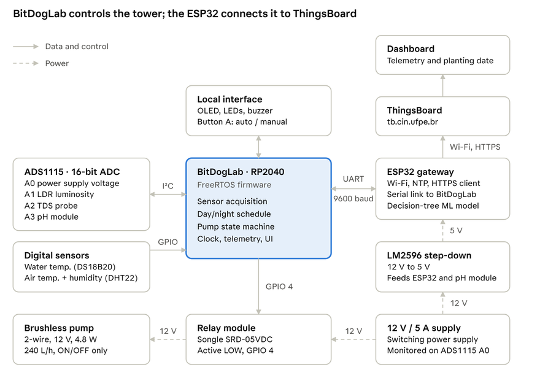
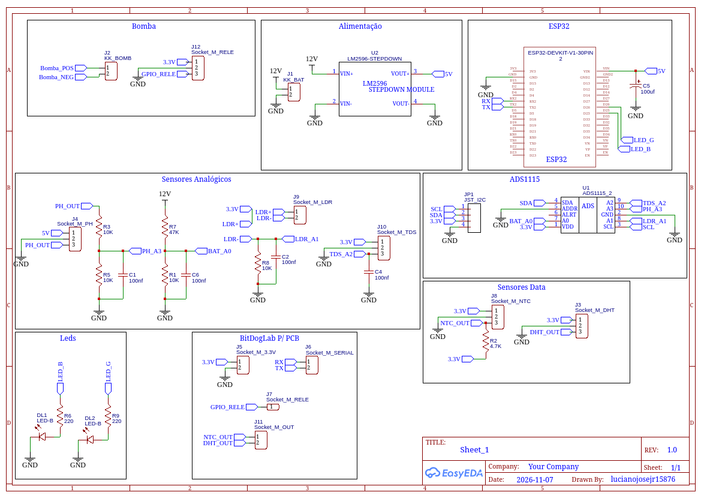

# AgriTower

<div align="center">

## 🌱 AgriTower

**Sistema embarcado para monitoramento, controle de irrigação e Edge AI em torres hidropônicas**

[](https://isocpp.org/)
[](https://www.raspberrypi.com/products/raspberry-pi-pico/)
[](https://www.espressif.com/)
[](https://freertos.org/)
[](https://platformio.org/)
[](https://thingsboard.io/)

</div>

O **AgriTower** integra aquisição de sensores, controle automático da bomba, sincronização de horário e diagnóstico inteligente de cultivos em alfaces. O projeto usa uma BitDogLab com Raspberry Pi RP2040 como unidade de controle e uma ESP32 como gateway de conectividade, ThingsBoard e inferência embarcada.

---

## 📊 Visão geral

```text
┌───────────────────────┐       Serial2 / UART       ┌──────────────────────┐
│  RP2040 / BitDogLab   │ <========================> │        ESP32         │
│                       │        9600 baud          │                      │
│ • FreeRTOS            │                            │ • Wi-Fi / Internet   │
│ • Sensores            │                            │ • NTP                │
│ • Irrigação           │                            │ • ThingsBoard        │
│ • OLED / botões       │                            │ • Modelo em Edge AI  │
└───────────────────────┘                            └──────────────────────┘
         │                                                        │
         ▼                                                        ▼
   Controle físico                                      Telemetria e dashboard
```

### Unidade de controle — BitDogLab / RP2040

- Executa tarefas concorrentes com **FreeRTOS**.
- Protege dados compartilhados com mutexes.
- Mede tensão, luminosidade, pH, TDS, temperatura da água, temperatura do ar e umidade.
- Controla uma bomba via relé.
- Permite modos automático e manual por meio de botões físicos.
- Exibe informações em um display OLED SSD1306.
- Envia telemetria à ESP32 e recebe a hora oficial por UART.

### Gateway — ESP32

- Conecta-se ao Wi-Fi e consulta hora via NTP.
- Envia `T:HH:MM` para o RP2040 a cada 60 segundos.
- Recebe telemetria pela `Serial2`.
- Consulta o atributo compartilhado `data_plantio` no ThingsBoard.
- Executa uma árvore de decisão embarcada para classificar o estado da alface.
- Compara os sensores com referências estatísticas associadas à idade do cultivo.
- Publica os resultados no ThingsBoard por HTTPS.

---

## 🏗️ Arquitetura do firmware

<div align="center">



*Figura 1 — fluxo das tarefas RTOS, comunicação entre placas e pipeline de diagnóstico.*

</div>

### Tarefas FreeRTOS da BitDogLab

| Tarefa | Responsabilidade |
| :--- | :--- |
| `vTaskSensores` | ADS1115, DHT22 e DS18B20 |
| `vTaskAgendamento` | Avaliação dos ciclos diurno e noturno |
| `vTaskBomba` | Comando do relé, LED verde e buzzer |
| `vTaskBotoes` | Debounce e troca de modo/override |
| `vTaskRelogio` | Recepção da hora pela UART e manutenção do relógio |
| `vTaskOled` | Atualização do display SSD1306 |
| `vTaskComunicacao` | Telemetria pela `Serial2` e painel pela porta USB |

O arquivo `main.cpp` libera a execução do loop principal para que as tarefas criadas pelo FreeRTOS permaneçam responsáveis pelo processamento.

### Módulos da ESP32

| Arquivo/módulo | Responsabilidade |
| :--- | :--- |
| `wifi_manager.cpp` | Conexão e reconexão Wi-Fi |
| `relogio_ntp.cpp` | Sincronização NTP e envio da hora |
| `serial_pico.cpp` | Recepção e interpretação dos pacotes do RP2040 |
| `tb_atributos.cpp` | Consulta de atributos compartilhados no ThingsBoard |
| `tb_telemetria.cpp` | Construção e envio do JSON por HTTPS |
| `plantio.cpp` | Processamento da data de plantio e idade do cultivo |
| `modelo_alface.cpp` | Diagnóstico por modelo embarcado |
| `modelo_alface.cpp` / `dataset_alface.cpp` | Referências estatísticas por dia de cultivo |
| `leds.cpp` | Indicação de Wi-Fi e recebimento de serial |

---

## 🔌 Hardware

### Componentes principais

- BitDogLab com Raspberry Pi RP2040
- ESP32
- ADS1115 — conversor analógico-digital de 16 bits
- DS18B20 — temperatura da solução nutritiva
- DHT22 — temperatura do ar e umidade relativa
- OLED SSD1306 de 128 × 64
- Sensores condicionados de pH, TDS e luminosidade
- Bomba submersível com chaveamento por relé
- Buzzer, LEDs e botões físicos

<div align="center">



*Figura 2 — esquemático de alimentação, aquisição e acionamentos.*

</div>

### Pinagem do RP2040

| Recurso | Pino/canal |
| :--- | :--- |
| Bomba — relé Active LOW | `GP4` |
| Botão A — override | `GP5` |
| Botão B — modo automático/manual | `GP6` |
| UART TX → ESP32 | `GP8` / `Serial2` |
| UART RX ← ESP32 | `GP9` / `Serial2` |
| Buzzer | `GP10` |
| LED verde da bomba | `GP11` |
| LED azul de telemetria | `GP12` |
| OLED SDA/SCL | `GP14` / `GP15` / `Wire1` |
| ADS1115 SDA/SCL | `GP0` / `GP1` / `Wire` |
| DS18B20 | `GP18` |
| DHT22 | `GP19` |

### Pinagem da ESP32

| Recurso | GPIO |
| :--- | :--- |
| UART2 RX — dados da BitDogLab | `16` |
| UART2 TX — hora para a BitDogLab | `17` |
| LED Wi-Fi | `25` |
| LED serial | `26` |

> Ajuste os pinos e os índices dos sensores se utilizar uma versão diferente da BitDogLab ou da ESP32.

---

## 📡 Comunicação Serial2

A UART usa **9600 baud** em ambos os firmware.

### RP2040 → ESP32

A BitDogLab envia uma linha terminada por `\n`:

```text
B:<tensao>,L:<luz>,TA:<temp_agua>,TR:<temp_ar>,U:<umid>,P:<ph>,S:<tds>,A:<auto>,E:<bomba>,C:<min>/<ciclo>,T:<HH>:<MM>
```

Exemplo:

```text
B:12.2,L:84,TA:24.5,TR:26.0,U:65,P:6.20,S:650,A:1,E:1,C:3/15,T:14:35
```

| Campo | Descrição |
| :--- | :--- |
| `B` | Tensão da alimentação/bateria |
| `L` | Luminosidade ambiente |
| `TA` | Temperatura da água |
| `TR` | Temperatura do ar |
| `U` | Umidade relativa |
| `P` | pH da solução |
| `S` | TDS em ppm |
| `A` | Modo: `1` automático, `0` manual |
| `E` | Estado da bomba: `1` ligada, `0` desligada |
| `C` | Progresso/minutos do ciclo |
| `T` | Hora atual da BitDogLab |

O parser da ESP32 aceita formatos completos e também pacotes curtos quando `E` e `C` não estão disponíveis.

### ESP32 → RP2040

A hora oficial é enviada no formato:

```text
T:14:35
```

A rotina tenta sincronizar imediatamente após o boot e repete a transmissão a cada 60 segundos.

---

## 🧠 Diagnóstico Edge AI

A ESP32 recebe `temperatura do ar`, `umidade`, `TDS`, `pH` e idade do cultivo em dias. Os dados são usados em uma árvore de decisão embarcada e classificados em:

- `0` — Crescendo
- `1` — Pronto para colher
- `2` — Estragado

Além da previsão, o firmware:

- calcula a idade pelo atributo compartilhado `data_plantio`;
- aceita datas `AAAA-MM-DD`, `DD/MM/AAAA` e timestamps;
- compara os sensores com referências mínimas, máximas, médias e percentis do dataset;
- gera alertas para sensores fora da faixa esperada;
- informa se os valores estão fora do intervalo observado no dataset;
- publica a conclusão e o nível de confiança no ThingsBoard.

O modelo e as referências estão implementados diretamente no firmware C++, permitindo inferência mesmo sem conexão com o Wi-Fi.

---

## ⏱️ Irrigação

O modo de operação pode ser alterado pelos botões da BitDogLab:

- **Modo automático:** segue o ciclo configurado pelo fotoperíodo.
- **Modo manual:** permite override direto da bomba pelo botão A.

O detalhamento dos tempos de acionamento deve ser confirmado no módulo `agendamento.cpp` antes do uso físico, pois pode variar conforme a configuração aplicada no projeto.

---

## ☁️ ThingsBoard

A telemetria é publicada em JSON por HTTPS no endpoint configurado em `Firmware_esp32/include/config.h`.

Campos enviados atualmente:

- `luminosidade`
- `temp_agua`
- `temp_ar`
- `umidade`
- `nivel_bateria`
- `ph`
- `ec`
- `bomba_ativa`
- `ciclo_bomba`
- `modo_automatico`
- `dias_crescimento`
- `status_alface`
- `status_alface_nome`
- `confianca_modelo`
- `leitura_confiavel`
- `alertas_alface`
- `conclusao_alface`
- `data_plantio_em_uso`
- `data_plantio_origem`

O atributo compartilhado consultado pela ESP32 é:

```text
data_plantio
```

Ele pode ser informado em `AAAA-MM-DD`, `DD/MM/AAAA` ou timestamp.

---

## 🛠️ Dependências

### BitDogLab / RP2040

- FreeRTOS do framework Arduino
- Adafruit ADS1X15
- OneWire
- DallasTemperature
- DHT sensor library
- Adafruit Unified Sensor
- Adafruit GFX Library
- Adafruit SSD1306

Definidas em `Firmware_bitdoglab/platformio.ini`.

### ESP32

- ArduinoJson

Definida em `Firmware_esp32/platformio.ini`.

---

## 🚀 Como executar

### Pré-requisitos

- Visual Studio Code
- Extensão PlatformIO IDE
- BitDogLab com RP2040
- ESP32
- Conexão Wi-Fi
- Dispositivo ou conta no ThingsBoard
- Cabeamento comum à tensão lógica de 3.3 V

### 1. Clonar o repositório

```bash
git clone https://github.com/lucianojrs1/AgriTower.git
cd AgriTower
```

### 2. Configurar a ESP32

Edite `Firmware_esp32/include/config.h` e substitua:

```cpp
const char* const ssid = "SUA_REDE_WIFI";
const char* const senha = "SUA_SENHA";
const char* const server = "https://SEU_SERVIDOR/api/v1/SEU_TOKEN/telemetry";
const char* const urlAtributos = "https://SEU_SERVIDOR/api/v1/SEU_TOKEN/attributes?sharedKeys=data_plantio";
```

Também configure o servidor NTP e o fuso horário necessários:

```cpp
const char* const ntpServer = "pool.ntp.org";
const long gmtOffset_sec = -10800;
const int daylightOffset_sec = 0;
```

Não publique tokens ou credenciais reais em repositórios públicos.

### 3. Compilar e carregar a ESP32

```bash
cd Firmware_esp32
pio run --target upload
pio device monitor --baud 115200
```

### 4. Compilar e carregar o RP2040

```bash
cd ../Firmware_bitdoglab
pio run --target upload
pio device monitor --baud 9600
```

A porta serial configurada no projeto é `/dev/ttyACM0` e pode precisar ser ajustada conforme o sistema operacional e a placa detectada.

### 5. Conectar a comunicação

```text
ESP32 TX2 (GPIO17) → RP2040 RX (GP9)
ESP32 RX2 (GPIO16) ← RP2040 TX (GP8)
GND ESP32        ─  GND RP2040
```

A alimentação da bomba deve permanecer separada dos circuitos lógicos conforme o esquemático, com aterramento e isolamento adequados.

---

## 📂 Estrutura do repositório

```text
AgriTower/
├── Firmware_bitdoglab/
│   ├── platformio.ini
│   ├── include/
│   │   ├── agendamento.h
│   │   ├── bomba.h
│   │   ├── botao.h
│   │   ├── comunicacao.h
│   │   ├── oled.h
│   │   ├── relogio.h
│   │   └── sensores.h
│   └── src/
│       ├── main.cpp
│       ├── agendamento.cpp
│       ├── bomba.cpp
│       ├── botao.cpp
│       ├── comunicacao.cpp
│       ├── oled.cpp
│       ├── relogio.cpp
│       └── sensores.cpp
├── Firmware_esp32/
│   ├── platformio.ini
│   ├── include/
│   └── src/
│       ├── main.cpp
│       ├── dataset_alface.cpp
│       ├── leds.cpp
│       ├── modelo_alface.cpp
│       ├── plantio.cpp
│       ├── relogio_ntp.cpp
│       ├── serial_pico.cpp
│       ├── tb_atributos.cpp
│       ├── tb_telemetria.cpp
│       └── wifi_manager.cpp
├── dataset/
│   └── archive.zip
├── docs/
│   ├── Esquematico.png
│   └── Fluxo2.png
└── README.md
```

---

## ⚠️ Segurança

Este projeto controla uma bomba elétrica e deve ser utilizado com os cuidados apropriados:

- utilize fonte e relé dimensionados para a carga;
- mantenha 12 V e 3.3 V eletricamente isolados quando necessário;
- adicione proteção contra polaridade reversa e sobretensão;
- use caixa apropriada para ambientes úmidos;
- não opere a bomba sem presença de líquido;
- confira aterramento, fusíveis e isolamento antes da energização;
- não use o firmware em ambiente produtivo sem adicionar proteção contra reservatório vazio.

---

## 🗺️ Roadmap

- [x] Controle multitarefa com FreeRTOS e mutexes
- [x] Aquisição de pH, TDS, luminosidade, temperatura e umidade
- [x] Interface OLED e indicadores locais
- [x] Irrigação automática por fotoperíodo
- [x] Comunicação UART entre RP2040 e ESP32
- [x] Sincronização NTP
- [x] Publicação no ThingsBoard
- [x] Diagnóstico Edge AI da alface
- [ ] Sensor de nível ou boia para bloqueio da bomba
- [ ] Controle automático de pH e condutividade
- [ ] Diagnóstico de falha de sensores
- [ ] Modo de operação totalmente offline
- [ ] Configuração do Wi-Fi sem editar o código-fonte

---

## 📄 Licença

Nenhuma licença foi definida neste repositório. Para uso, distribuição ou modificação, entre em contato com o proprietário ou defina uma licença no projeto.

## 👤 Autor

**Luciano José**

Repositório: [lucianojrs1/AgriTower](https://github.com/lucianojrs1/AgriTower)
